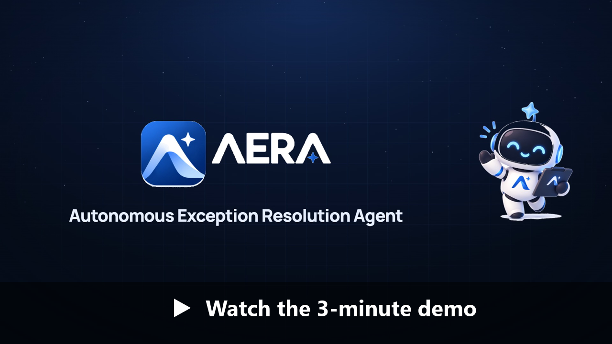
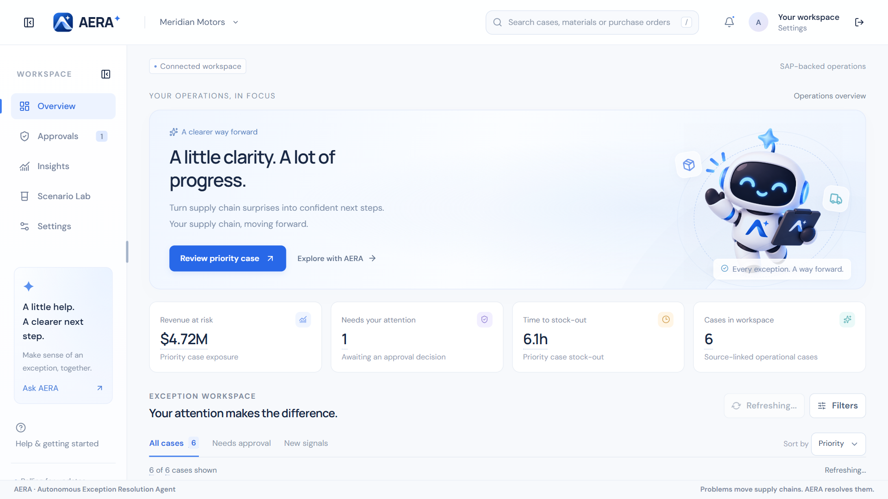
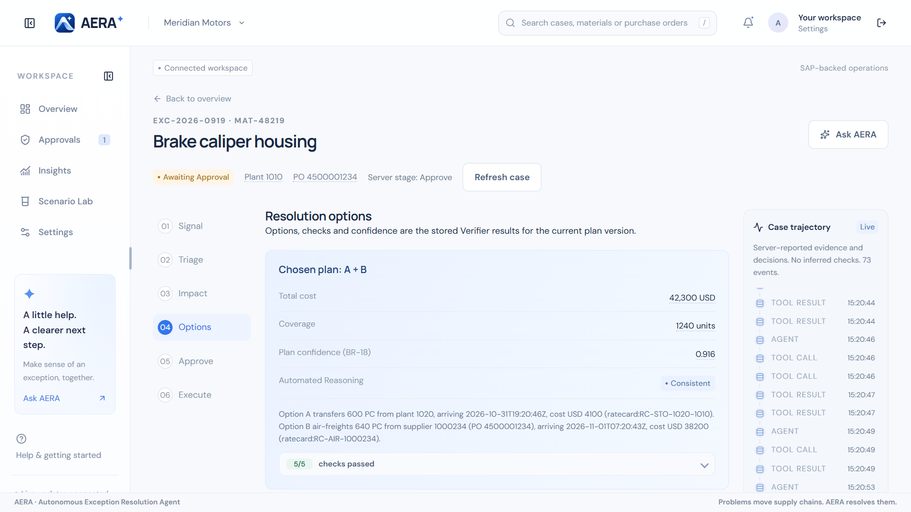
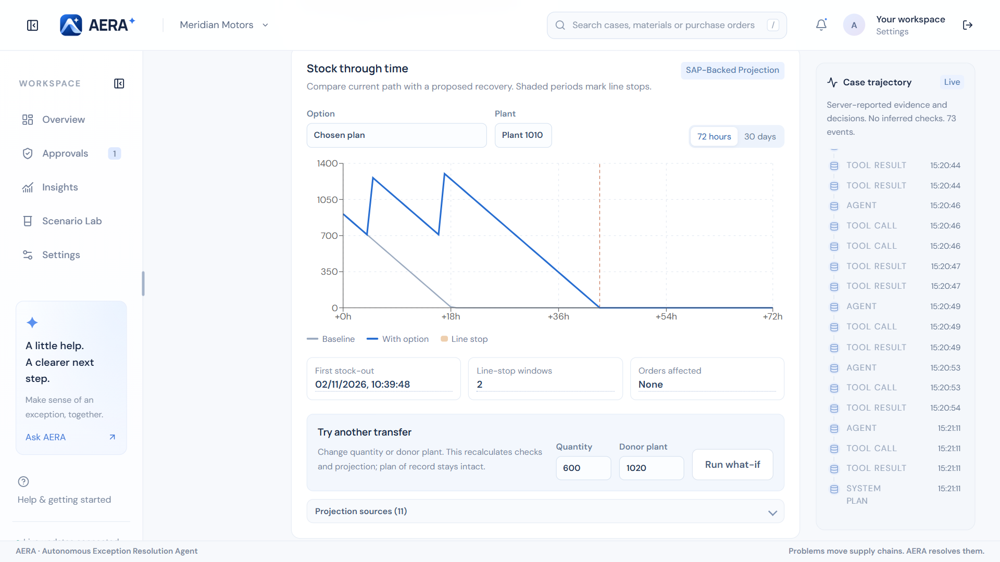
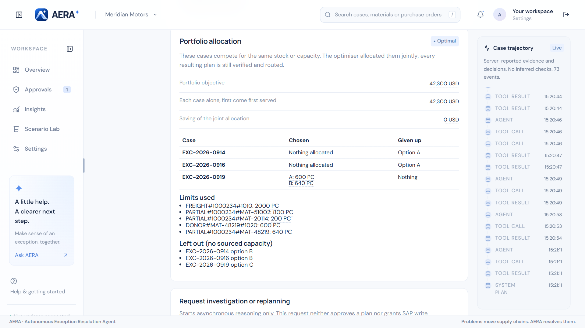
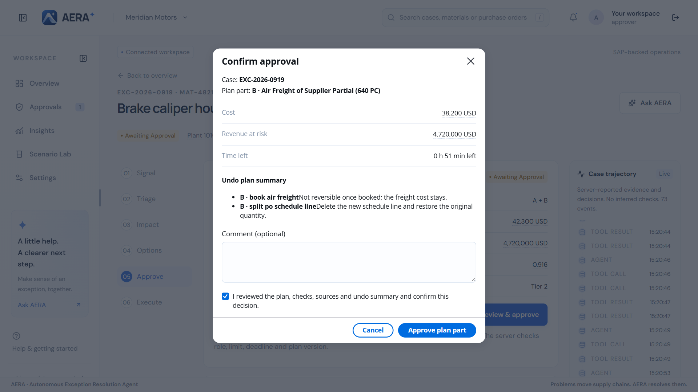
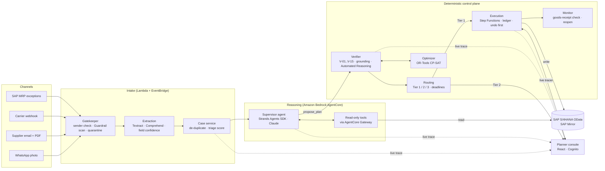

<div align="center">

# AERA — Autonomous Exception Resolution Agent

**Agentic AI that takes a supply chain exception from a raw supplier message to a verified, approved and reversible correction in SAP S/4HANA.**

🏆 **1st place — AWS / SAP Agentic AI Hackathon, Asia Pacific 2026** (Intelligent Supply Chain track)<br>
640 entries → 40 finalists → 1 winner

[Demo video](#demo) · [How it works](docs/HOW_IT_WORKS.md) · [Architecture](docs/ARCHITECTURE.md) · [Safety and governance](docs/GOVERNANCE.md) · [Console (aera-fe)](https://github.com/aera-scm/aera-fe)


</div>

---

## The problem

It is two in the morning at a car parts plant. A supplier's casting line has failed and the
brake caliper housing for plant 1010 will run out in about six hours. The news does not
arrive as clean data. It arrives as a **WhatsApp photo of a delivery note**, an **email with a
PDF**, a **carrier notice** and an **MRP alarm in SAP** — next to 200 other alarms that do not
matter tonight.

A planner has to work out which alarm is real, which customer orders are hit, what the
options cost, who may approve them, and then type the fix into SAP without making it worse.
That takes hours. **AERA does it in minutes**, and it never lets the language model write to
SAP on its own.

## What AERA does

| | |
|---|---|
| **Reads what planners read** | Supplier email and PDFs, WhatsApp photos, carrier webhooks and SAP MRP exceptions, in English, Bahasa Indonesia and German. 214 MRP messages become 6 real cases, ranked by revenue at risk. |
| **Grounds every number in SAP** | Every figure on screen carries a `sourceRef` back to the SAP record, rate card or planner confirmation it came from. Where a message and SAP disagree, SAP wins. |
| **Quantifies the impact** | Which customer orders are exposed, when the line stops, how much revenue is at risk. |
| **Proposes and optimises** | Inter-plant transfer, air freight, PO re-schedule, alternate supplier — with cost, arrival and a time-phased stock projection. A CP-SAT solver allocates shared stock across competing cases. |
| **Verifies deterministically** | 15 coded checks (V-01..V-15), a grounding score and Amazon Bedrock Automated Reasoning re-check every plan. The model proposes; code decides. |
| **Decides how much to automate** | Small, reversible, high-confidence actions run at once (Tier 1). Expensive or irreversible ones go to a named approver with a deadline (Tier 2). Anything uncertain escalates to a human (Tier 3). |
| **Executes safely** | A Step Functions workflow reserves stock, saves the undo plan **before** the first write, writes idempotently to SAP, verifies each document and reopens the case if the goods never arrive. |
| **Cannot be talked around** | Supplier content is evidence, never instruction. Prompt injection is quarantined at the gate, and no chat message can approve, execute or change a threshold. |

## Demo

[](docs/media/aera-demo.mp4)

**[▶ Watch the demo (3:37, MP4)](docs/media/aera-demo.mp4)** — recorded end to end against the
live AWS environment: the agent escalates because a quantity was confirmed only by the
carrier, the planner confirms it, AERA re-plans, the stock transfer runs automatically, the
air freight goes to an approver on a phone, and both are written to SAP with their undo steps.

### Screenshots

| | |
|---|---|
|  **Overview board** — exceptions ranked by revenue at risk and time to stock-out. |  **Every figure is sourced** — hover any number to see the SAP record behind it. |
|  **Signals and extracted fields** — sender verified, guardrail passed, each field matched against SAP. |  **Options** — the chosen plan with cost, coverage, deterministic confidence and Automated Reasoning result. |
|  **Stock through time** — with and without the plan, plus a what-if transfer. |  **Portfolio allocation** — the optimiser shares scarce stock across cases. |
|  **Ask AERA** — asked to skip the approval, it refuses and cites the rule (BR-05, BR-16). |  **One deliberate approval** — cost, revenue at risk, time left and the undo plan. |
|  **Governed execution** — SAP document numbers, each with its undo step. |  **Phone-first approvals** for approvers on the move. |

The full walkthrough with every screen is in **[docs/HOW_IT_WORKS.md](docs/HOW_IT_WORKS.md)**.

## Architecture



The language model sits in exactly one box, and that box has read-only tools. Verification,
routing, stock reservation and every SAP write are ordinary, tested code. Details:
**[docs/ARCHITECTURE.md](docs/ARCHITECTURE.md)**.

## Tech stack

| Layer | Technology |
|---|---|
| Agent | Strands Agents SDK on **Amazon Bedrock AgentCore** Runtime + Gateway; Claude Sonnet (supervisor), Amazon Nova Lite (extraction) |
| Safety | Amazon Bedrock Guardrails (prompt attack, contextual grounding), **Automated Reasoning** policy checks |
| Documents and language | Amazon Textract, Amazon Comprehend |
| Workflow | AWS Step Functions (Standard), AWS Lambda (Python 3.12, ARM64), Amazon EventBridge + Scheduler |
| Optimisation | Google OR-Tools CP-SAT in a Lambda container |
| Data | Amazon DynamoDB (10 tables, conditional writes), Amazon S3 (Object Lock audit archive), AWS KMS |
| API and identity | Amazon API Gateway (REST + WebSocket), Amazon Cognito (branded managed login, planner / approver / admin groups) |
| System of record | SAP S/4HANA OData APIs; **SAP Mirror** — an SAP CAP service generated from SAP's published S/4HANA schemas, on SAP BTP or ECS Fargate |
| Interop | A2A agent endpoint and read-only MCP server on AgentCore Runtime |
| Infrastructure | AWS CDK v2 (Python), 10 stacks, budget-gated deploys |
| Console | React 18, TypeScript, Vite, Cloudscape — see [aera-fe](https://github.com/aera-scm/aera-fe) |

## Results

Measured in the live `dev` environment on the reference scenario (synthetic SAP data):

- **214 MRP messages → 6 actionable cases**; the reference case ranks first at **USD 4.72 M** revenue at risk, **6.2 h** to stock-out.
- **Hostile signals quarantined**: six injected or look-alike-sender messages stopped at the gate, with audit.
- **Re-plan in ~60–90 s** of agent time (warm reference run measured at 61 s).
- **Plan confidence 0.916**, Automated Reasoning `CONSISTENT`, all blocking checks passed.
- **Urgent partial execution (BR-22)**: the USD 4,100 stock transfer ran immediately as Tier 1; the USD 38,200 air freight waited for a named approver.
- **Undo saved before the first write**, STO and PO schedule-line split written to SAP, replays produced **no duplicate documents**.
- **1,399 backend tests** and **108 console unit tests** pass; a **150-case evaluation set** (including 30 adversarial cases) runs offline in CI.

## Repository layout

```text
infra/            AWS CDK app: data, identity, edge, gate, reasoning, control,
                  interop, web, observability, mirror stacks + standalone budget app
services/
  agent/          supervisor agent (Strands) and versioned system prompts
  tools/          read-only agent tools (SAP reads, impact and option calculators)
  gatekeeper/     sender verification, Guardrail scan, quarantine
  extraction/     Textract / Comprehend field extraction with confidence
  case_service/   de-duplication, case lifecycle, triage score
  verifier/       V-01..V-15, grounding, Automated Reasoning, plan confidence
  routing/        autonomy tiers, urgent split, approval deadlines
  optimizer/      CP-SAT portfolio allocation and stock projection
  execution/      Step Functions steps: ledger, undo, idempotent SAP writes
  monitor/        goods-receipt checks, close or reopen
  dialogue/       structured supplier questions and reply parsing
  api/ realtime/  console REST API, chat, what-if, WebSocket push
  interop/        A2A and MCP endpoints
  rules/          business rules BR-xx as pure functions
  lab/            Scenario Lab: generate realistic disruptions on demand
sap-mirror/       SAP CAP service with the S/4HANA schema and the reference scenario
eval/             evaluation harness and 150 scored cases
scripts/          checks, deploy helpers, signal replay, synthetic data
tests/            cross-service and contract tests
docs/             architecture, walkthrough, governance, deployment, development
```

## Quick start

Everything except the live agent runs locally without an AWS account.

```sh
uv sync --locked                                     # Python 3.12, uv
uv run --locked python scripts/check.py              # lint, types, tests, secret scan, audit
uv run --locked python eval/runner.py --subset ci    # offline evaluation harness
make mirror-local                                    # SAP Mirror on http://localhost:4004
```

To run the console against offline demo data, see [aera-fe](https://github.com/aera-scm/aera-fe).
Deploying to your own AWS account is described in **[docs/DEPLOYMENT.md](docs/DEPLOYMENT.md)**;
development workflow and tests in **[docs/DEVELOPMENT.md](docs/DEVELOPMENT.md)**.

## Documentation

| Document | Contents |
|---|---|
| [How it works](docs/HOW_IT_WORKS.md) | The reference scenario, screen by screen |
| [Architecture](docs/ARCHITECTURE.md) | Components, trust zones, event flow, data stores, CDK stacks |
| [Safety and governance](docs/GOVERNANCE.md) | Business rules, verifier checks, autonomy tiers, execution guarantees, prompt-injection defence |
| [Deployment](docs/DEPLOYMENT.md) | Budget gate, region and model checks, configuration, deploy and teardown |
| [Development](docs/DEVELOPMENT.md) | Local setup, checks, tests, evaluation harness, CI |
| [Release runbook](docs/final-runbook.md) | Checklist for a frozen presentation environment |
| [SAP Mirror metadata](sap-mirror/metadata/README.md) | Official SAP schema inventory and sandbox checks |

## Project status

AERA was built during the hackathon (September–October 2026) and ran live in an AWS `dev`
environment for the final. After the event the cloud environment was decommissioned to stop
costs, so the hosted console is no longer online; the demo video and screenshots above were
recorded against that live environment. The code deploys again with one command
([docs/DEPLOYMENT.md](docs/DEPLOYMENT.md)).

All scenario data — companies, suppliers, people, phone numbers, emails — is synthetic.

## Author

**Raynald Arvan Lim** — [github.com/DlegendZ](https://github.com/DlegendZ)

## License

[MIT](LICENSE)
