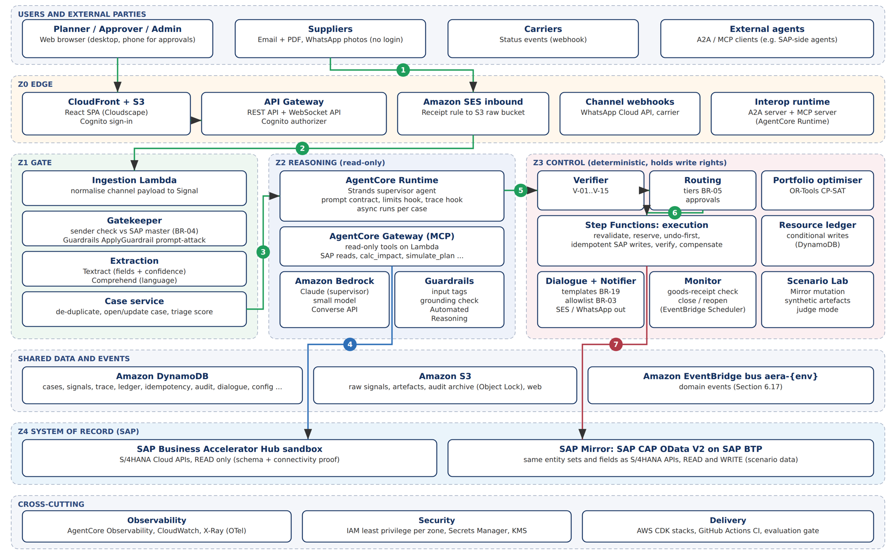
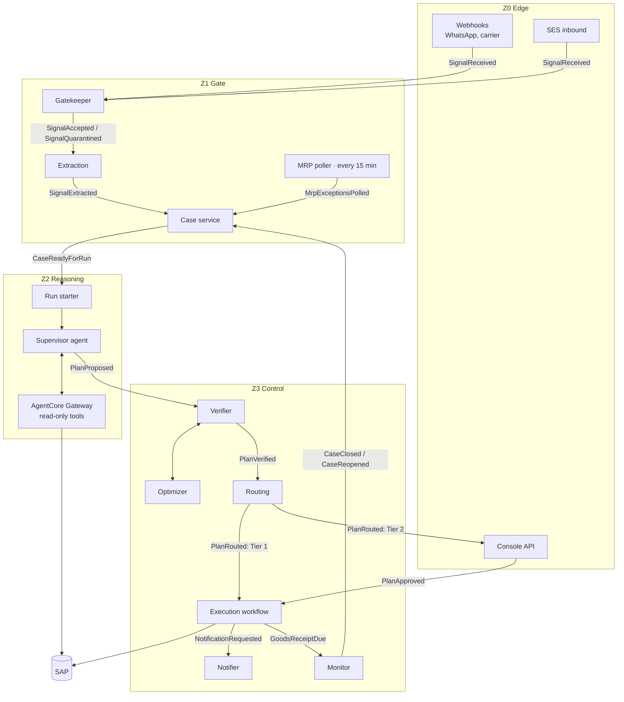
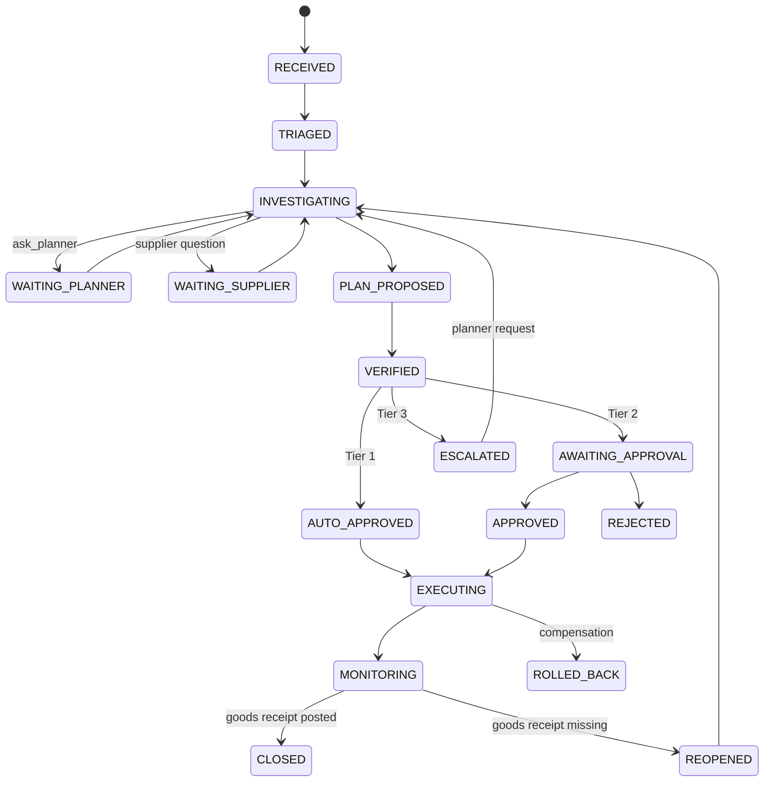
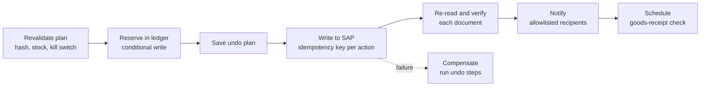

# Architecture

AERA is a serverless, event-driven system on AWS with SAP S/4HANA as the system of record.
One supervisor agent reasons over a case with read-only tools; everything that decides,
reserves or writes is deterministic code.

*The SAP Mirror runs either on SAP BTP (CAP, HANA Cloud, XSUAA) or, as deployed for the
hackathon, on Amazon ECS Fargate with the same OData contract.*

## Design principles

1. **One reasoning thread, narrow tools.** A single supervisor agent holds the full case
   context. Specialist work is done by tools, not by a crowd of agents, so context never
   fragments.
2. **The model proposes; code disposes.** The agent can read and propose. Verification,
   routing, reservation and writing are deterministic services with unit tests named after
   the rule they implement.
3. **Numbers are fetched, never generated.** Every figure has a SAP source reference and is
   re-read before it is written.
4. **Untrusted content is data.** External content is gated by sender, scanned, tagged and
   never grants authority.
5. **Every write is reversible or approved.** Undo first, idempotent writes, reopen on miss.

## Trust zones

| Zone | Components | May do | May not do |
|---|---|---|---|
| **Z0 Edge** | CloudFront + S3 console, API Gateway REST + WebSocket, SES inbound, channel webhooks, A2A / MCP interop runtime | Authenticate callers, store raw payloads, emit events | Reason, write SAP |
| **Z1 Gate** | Gatekeeper, extraction, case service, MRP poller | Read master data, write signals and cases | Use tools, write SAP |
| **Z2 Reasoning** | AgentCore Runtime (Strands supervisor), AgentCore Gateway with read-only tool Lambdas, Bedrock models | Read SAP and case data, `ask_planner`, `propose_plan` | Write SAP, send messages, start workflows |
| **Z3 Control** | Verifier, routing, optimizer, execution workflow, ledger, dialogue, notifier, monitor, lab | Write SAP (execution only), send allowlisted messages (notifier only), reserve stock | — |
| **Z4 System of record** | SAP S/4HANA APIs (sandbox, read) and SAP Mirror (read / write) | — | — |

IAM mirrors the zones: the only role with SAP write access is the execution workflow role,
and the only role that can message the outside world is the notifier role. The console API
checks authorisation twice — the Cognito authorizer at API Gateway and a group check per
endpoint in the handler.

## Main flow

Components communicate only through the `aera-{env}` EventBridge bus. Failed deliveries land
in dead-letter queues instead of vanishing. The case service runs with reserved concurrency
1, so two events can never open the same case twice.

### Domain events

| Event | Producer → consumer |
|---|---|
| `SignalReceived` | webhooks, SES inbound, interop, lab → gatekeeper |
| `SignalAccepted`, `SignalQuarantined` | gatekeeper → extraction, audit |
| `SignalExtracted` | extraction → case service, dialogue |
| `MrpExceptionsPolled` | MRP poller → case service |
| `CaseOpened`, `CaseUpdated`, `CaseReadyForRun` | case service → run starter, realtime |
| `PlanProposed` | agent (`propose_plan`) → verifier |
| `PlanVerified`, `PortfolioSolved` | verifier, optimizer → routing |
| `PlanRouted` | routing → execution (Tier 1), console (Tier 2), escalation (Tier 3) |
| `PlanApproved`, `PlanRejected` | console API → execution, case service |
| `ExecutionStarted`, `ExecutionCompleted`, `ExecutionFailed` | execution → case service, realtime |
| `NotificationRequested` | execution, dialogue → notifier |
| `SupplierInfoRequested`, `SupplierReplyMatched` | agent, dialogue → dialogue, case service |
| `GoodsReceiptDue`, `CaseClosed`, `CaseReopened` | execution, monitor → case service |

### Case lifecycle

## The agent

- **Runtime.** A Python 3.12 ARM64 container on Amazon Bedrock AgentCore Runtime, built with
  the Strands Agents SDK. Runs are asynchronous (AgentCore synchronous entry points time out),
  one active run per case.
- **Models.** Claude Sonnet on Amazon Bedrock as supervisor; Amazon Nova Lite for field
  extraction and normalisation. Model IDs are configuration, validated before deploy.
- **Tools** (each its own Lambda with its own IAM role, registered as an AgentCore Gateway
  target, IAM-authenticated):
  `sap_get_purchase_order`, `sap_get_stock`, `sap_get_production_orders`,
  `sap_get_sales_orders`, `sap_get_supplier`, `calc_impact`, `find_sources`, `calc_option`,
  `get_supplier_reliability`, `get_case_evidence`, plus `ask_planner` and `propose_plan`.
- **Limits** (BR-11): at most 20 model iterations, 150,000 tokens and 300 s per run, three
  re-plans per case. Reaching a limit escalates; it never fails silently.
- **Hooks** write every model step and tool call to the trace table, which streams to the
  console's case trajectory.
- **Prompts** are versioned files (`services/agent/prompts/supervisor_v1..v6.md`); the version
  is recorded with every plan.

## Verification and routing

The verifier re-reads every figure in a proposed plan from SAP and runs the checks
V-01..V-15, a contextual grounding check and an **Amazon Bedrock Automated Reasoning** policy
(approval, donor cover and revenue-at-risk rules written as formal logic). It then computes
plan confidence by formula (BR-18). Routing assigns the autonomy tier, splits urgent plans
(BR-22), assigns the approver and sets the approval deadline (BR-23). See
[GOVERNANCE.md](GOVERNANCE.md) for every rule and check.

The **optimizer** (Google OR-Tools CP-SAT in a Lambda container) detects cases that compete
for the same stock, freight or supplier capacity and allocates them jointly, minimising action
cost plus uncovered revenue at risk. It also produces the time-phased stock projections and
what-if recalculations shown in the console.

## Execution

An AWS Step Functions Standard state machine performs every SAP write:

SAP writes follow S/4HANA's own protocol: CSRF token fetch, `If-Match` ETags (428 without,
412 when stale), deep insert of stock transport orders, schedule-line splits and goods
receipts.

## SAP integration

- **Reads** use the S/4HANA Cloud OData APIs for purchase orders, stock, production orders,
  sales orders, suppliers and material documents. The SAP Business Accelerator Hub sandbox
  was used to prove the schema and connectivity (read-only).
- **The SAP Mirror** (`sap-mirror/`) is an SAP CAP service whose model is generated from SAP's
  published service schemas, exposing the same entity sets under the same
  `/sap/opu/odata/sap/<API>` paths as a real tenant. It holds the reference scenario and
  accepts writes, so pointing AERA at a licensed S/4HANA system is a configuration change.
- Custom entities (MRP exception feed, consumption rates) live in the customer-namespace
  service `ZAERA_MIRROR_SRV`.

## Data stores

| Store | Purpose |
|---|---|
| `aera-{env}-cases` | Cases, plans, plan parts, routing, approvals |
| `aera-{env}-signals` | Raw signal metadata, extracted fields and confidence |
| `aera-{env}-trace` | Agent steps and tool calls (streamed to the console) |
| `aera-{env}-ledger` | Stock reservations, first committed reservation wins |
| `aera-{env}-idempotency` | Write results keyed by `sha256(case, plan version, action, target)` |
| `aera-{env}-audit` | Every decision and override; archived to S3 Object Lock |
| `aera-{env}-dialogue` | Supplier conversations |
| `aera-{env}-analytics` | Supplier reliability, KPIs |
| `aera-{env}-config` | Thresholds, rate card, kill switch |
| `aera-{env}-connections` | WebSocket connections |
| S3 `raw` / `artefacts` / `audit` | Raw payloads (90-day expiry), decision records, audit archive (Object Lock, compliance mode) |

All tables are on-demand with point-in-time recovery; every store is encrypted with the
project KMS key.

## CDK stacks

| Stack | Contents |
|---|---|
| `aera-{env}-budget` | Standalone app: AWS Budget with alerts at 50 / 80 / 100 %, deployed before anything else |
| `aera-{env}-data` | DynamoDB tables, S3 buckets, KMS key, EventBridge bus, SSM parameters, secret containers |
| `aera-{env}-identity` | Cognito user pool, groups, app client, branded managed login |
| `aera-{env}-edge` | REST and WebSocket APIs, webhooks, SES inbound |
| `aera-{env}-gate` | Gatekeeper, extraction, case service, MRP poller, input Guardrail |
| `aera-{env}-reasoning` | Tool Lambdas, AgentCore Gateway, AgentCore Runtime, run starter, Automated Reasoning policy |
| `aera-{env}-control` | Verifier, routing, optimizer, execution state machine, dialogue, notifier, monitor, analytics, lab |
| `aera-{env}-interop` | AgentCore Runtime for the A2A and MCP endpoints |
| `aera-{env}-web` | Console bucket, CloudFront with Origin Access Control and security headers |
| `aera-{env}-mirror` | SAP Mirror on ECS Fargate behind an HTTP API (when SAP BTP is not used) |
| `aera-{env}-observability` | Dashboards, alarms, log retention |

Naming follows `aera-{env}-{component}` for resources, `/aera/{env}/...` for parameters and
secrets. Every resource is tagged `project`, `env`, `component` and `owner` for cost reports.

## Interoperability

A second AgentCore Runtime exposes an **A2A** agent endpoint and a read-only **MCP** server, so
other agents — including SAP-side agents — can submit exceptions and read results. Their
requests are treated as signals, never instructions: they pass the gate, cannot approve,
execute or change configuration, and are rate-limited per client (BR-21). Clients
authenticate with OAuth client credentials through AgentCore Identity.

## Observability

Every agent run is traced with OpenTelemetry (AgentCore Observability, CloudWatch, X-Ray).
The trace table gives the console a step-by-step trajectory of each case, and the audit table
records every decision, approval, override and configuration change.
