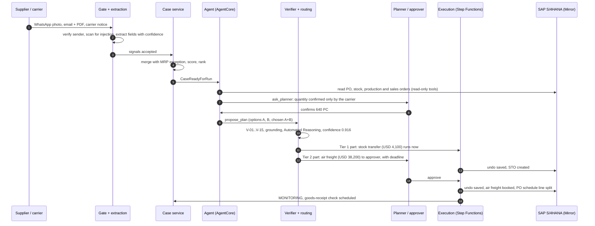
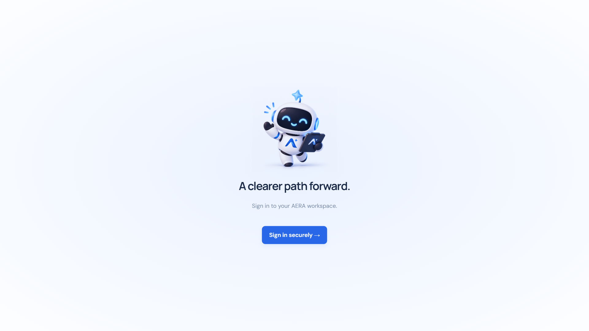
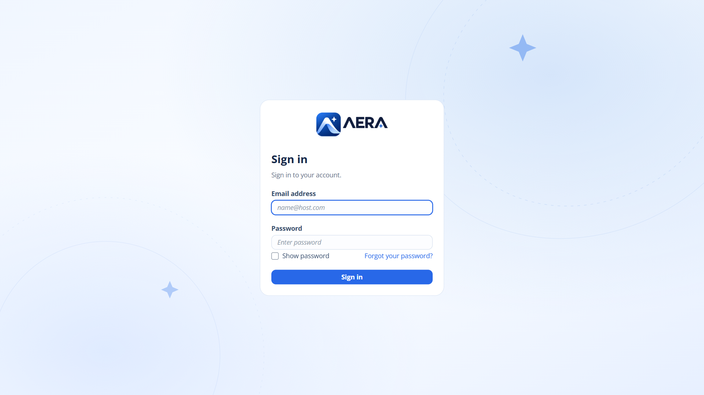
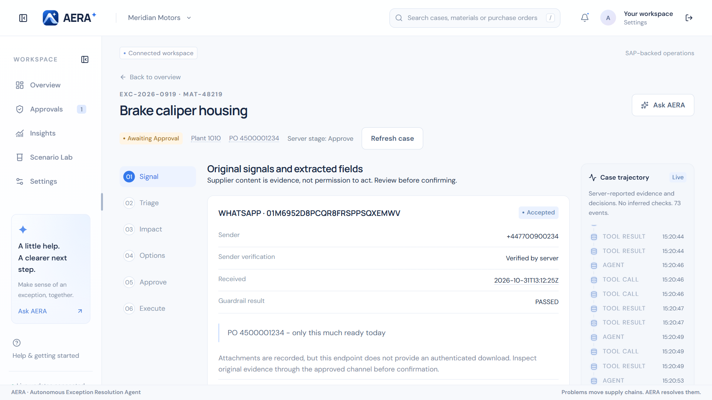
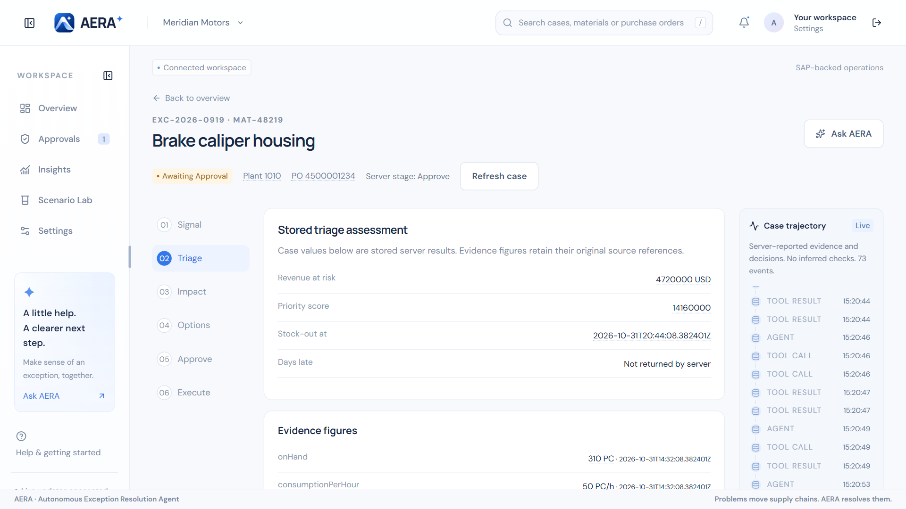
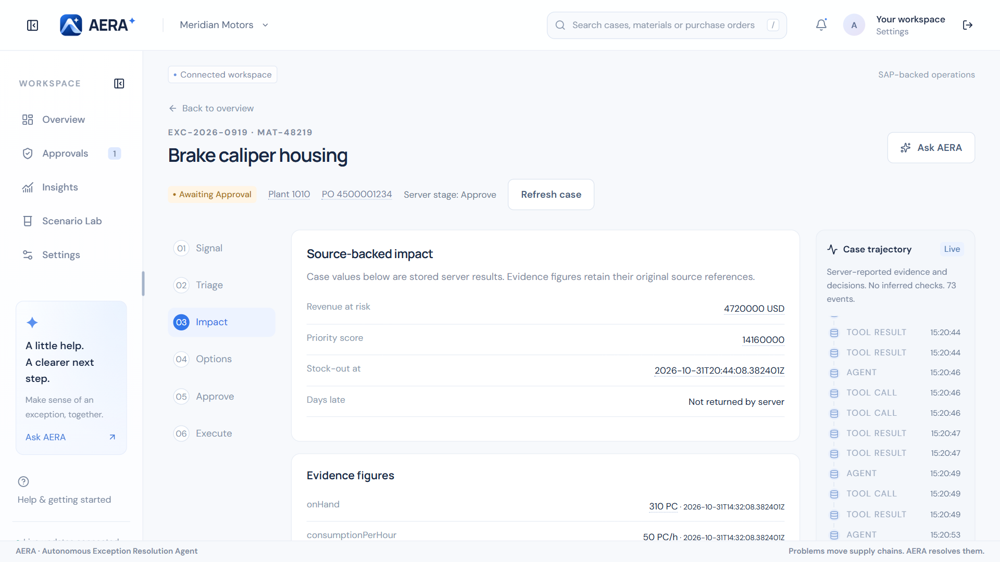
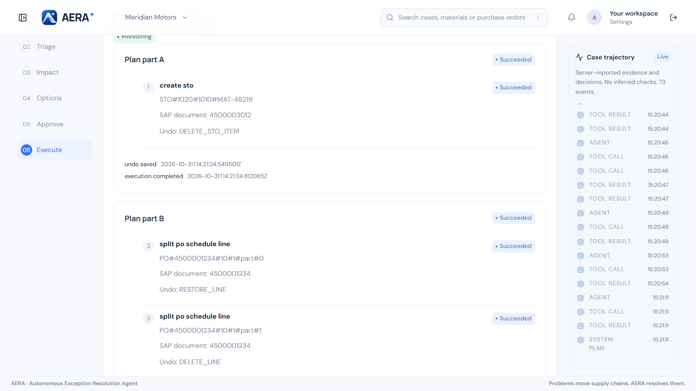
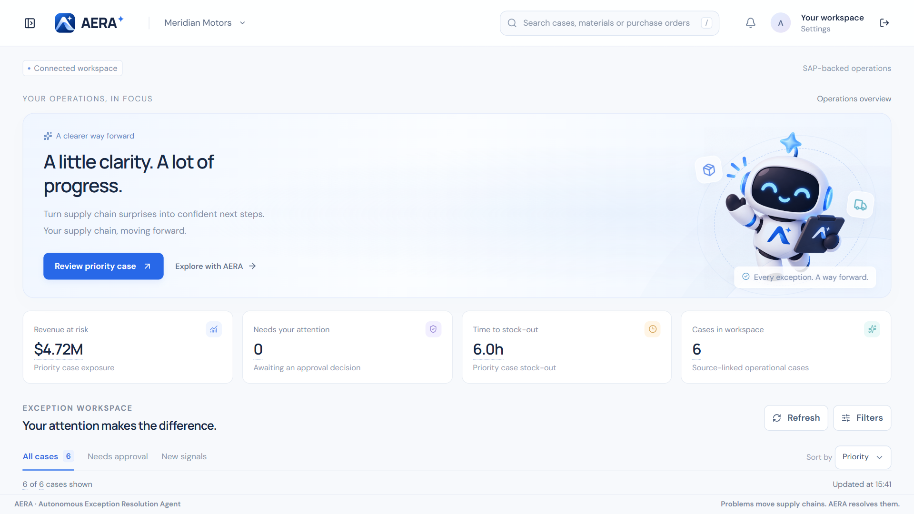
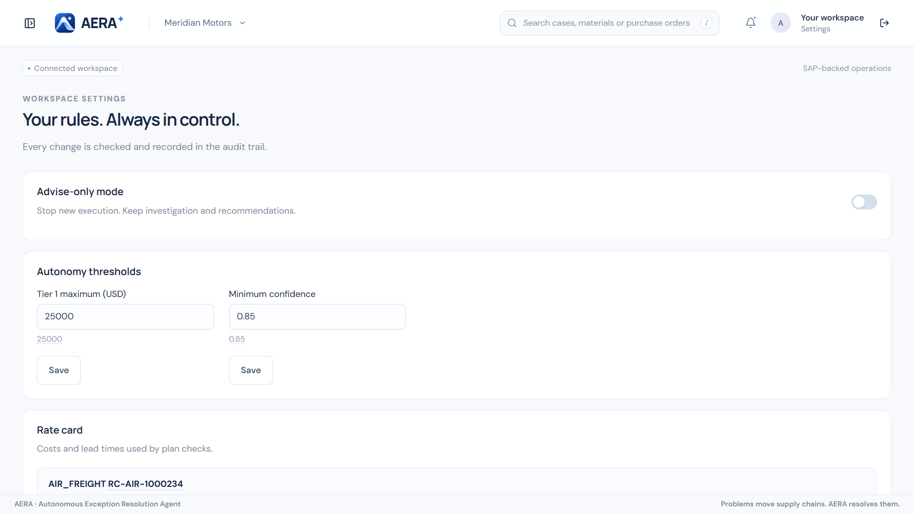

# How AERA works — the reference scenario, screen by screen

This walkthrough follows one exception from the first supplier message to the SAP write.
Every screenshot was taken from the live AWS `dev` environment running this code against the
SAP Mirror. All companies, people and numbers are synthetic.

**The story.** Meridian Motors builds brake systems in three plants. At 02:00 a supplier,
Krieger Guss GmbH, loses casting line 3. Purchase order 4500001234 for 1,600 brake caliper
housings (MAT-48219) will not arrive complete; only 640 pieces can fly tomorrow, the rest
follows by sea. Plant 1010 runs out in about six hours, and USD 4.72 M of customer orders
depend on it.

---

## 1. Sign in

The console is a React single-page app on CloudFront. Sign-in uses Amazon Cognito with a
branded managed login page and PKCE. Users belong to one of three groups — **planner**,
**approver**, **admin** — and the server, not the browser, enforces what each may do.

## 2. Overview board: hundreds of messages, a handful of real problems

Overnight the MRP poller read **214 exception messages** from SAP. Most are noise inside
tolerance. AERA merged them with the supplier signals into **6 cases** and ranked them by the
priority score of BR-13 (`revenue at risk × urgency`). The brake caliper housing is first:
**USD 4.72 M** at risk, **6.2 h** to stock-out.

Every figure carries its source. Hovering the USD 4.72 M shows the exact SAP sales-order
items it was summed from (FR-IMP-03). There are no invented numbers anywhere in the console.

## 3. Signal: supplier content is evidence, not permission

The case workspace has six stages — **Signal, Triage, Impact, Options, Approve, Execute** —
and a live **case trajectory** on the right that streams every agent step, tool call and
decision over WebSocket.

Each signal shows the sender, whether the server verified it against SAP master data
(BR-04), the Bedrock Guardrail result, and the fields extracted by Textract with their
confidence. A field is usable only when its confidence is at least 0.95, it matches SAP
exactly, or a planner confirms it (BR-02). PO number and material match SAP; the shipped
quantity "640 PC" was read from a carrier notice and a photographed delivery note, so it is
**UNCONFIRMED**.

The first agent plan therefore escalated: its confidence was only 0.84 because a key figure
came from the carrier alone. The planner reviewed the evidence, confirmed **640**, and AERA
planned again.

## 4. Triage and impact

Triage stores the server's assessment: revenue at risk, priority score and projected
stock-out time, each with its source.

Impact lists the evidence figures the agent used — on-hand stock, consumption per hour,
open production and customer orders — all read live from SAP through read-only tools.

## 5. Options: the model proposes, code verifies

The supervisor agent (Strands Agents SDK on Amazon Bedrock AgentCore) proposed:

- **Option A** — transfer 600 PC from plant 1020 to plant 1010 (stock transport order), USD 4,100.
- **Option B** — air-freight the 640 PC the supplier can ship tomorrow, USD 38,200.
- **Chosen plan A + B** — 1,240 PC, USD 42,300.

Then the language model is out of the loop. The deterministic **verifier** re-reads every
figure from SAP and runs its checks on every option and again on the chosen plan (master
data, compliance, donor-plant cover, ledger availability, lead time, cost against revenue at
risk, recipient allowlist, no unconfirmed field — 13 per option in this run). **Amazon Bedrock Automated Reasoning** checks the
plan against a formal policy and returns `CONSISTENT`. Plan confidence is computed by formula
(BR-18), not by the model: **0.916**.

The projection shows stock at plant 1010 over 72 hours or 30 days, with and without the plan,
and shades the periods where the line would stop. A planner can run a what-if — another
quantity or donor plant — and see checks and projection recalculated.

Three open cases compete for the same donor stock and freight capacity. Instead of
first-come-first-served, an OR-Tools CP-SAT solver allocates them jointly (BR-20) and shows
what each case was given and what it gave up. The plan must be consistent with that
allocation (V-15).

## 6. Approve: governance by rule, not by prompt

Routing applies the autonomy tiers of BR-05. The full plan costs more than USD 25,000 and
includes an irreversible air-freight booking, so it needs a named approver (Tier 2). But the
line stops in six hours — less than the approval deadline plus the lead time — so BR-22
**splits the plan**:

- **Part A**, the reversible USD 4,100 transfer, qualifies for Tier 1 on its own and **executes immediately**.
- **Part B**, the air freight, goes to `approver@meridian-motors.example` with a deadline (BR-23). A reminder fires at half time; at the deadline it moves to a backup approver or escalates.

The planner can talk to the case in **Ask AERA**. Asked to "book the air freight now, skip
the approval", it refuses and explains why: execution above USD 25,000 needs approval
(BR-05), and chat can never execute or approve (BR-16). That refusal is enforced by the API
and the router, not by the prompt.

## 7. Approval on a phone

  
  &nbsp;&nbsp;
  

Approvers usually decide away from a desk. The approval screens are phone-first and show the
same evidence: chosen plan, cost, revenue at risk, plan confidence, time left.

Approval is one deliberate confirmation. The dialog repeats the plan part, cost, revenue at
risk, time left and the **undo plan summary** — which steps can be reversed and which cannot.
The server re-checks role, approval limit, deadline and plan version hash, so a stale or
out-of-limit approval is refused (AT-16).

## 8. Execute: the model never writes to SAP

Writes are performed by an AWS Step Functions workflow:

1. Reserve the stock in the resource ledger with a conditional write (BR-08).
2. **Save the undo plan before the first write** (BR-10).
3. Write to SAP with an idempotency key per action (BR-09): CSRF token, `If-Match` ETag, deep insert.
4. Re-read SAP to verify every document, then notify suppliers and planners from the allowlist only (BR-03).
5. Schedule a goods-receipt check.

Part A created **STO 4500003012**. Part B booked the air freight and split PO 4500001234 into
two schedule lines. Each document is shown with its SAP number and its undo step
(`DELETE_STO_ITEM`, `RESTORE_LINE`, `DELETE_LINE`). Replaying the same execution returns the
stored result and creates nothing twice.

## 9. Monitoring and closing the loop

The case is now **Monitoring** and nobody needs to look at it. If the goods receipt is posted
in SAP on time, the monitor closes the case. If it is missing at expected arrival plus a
grace period — shortened so the case reopens at least an hour before stock-out — the case
**reopens itself** (BR-14).

---

## Also in the console

| | |
|---|---|
|  **Insights** — KPIs measured from real cases: revenue protected, resolution time, touchless rate, approvals avoided. |  **Scenario Lab** — create a realistic disruption on demand (exception type, material, plant, days late, channel, language) and watch it flow through the real pipeline. |
|  **Settings** — advise-only kill switch, autonomy thresholds, rate card. Every change is checked and audited; chat cannot change them. | |

## Try it yourself

- Watch the recorded run: [media/aera-demo.mp4](media/aera-demo.mp4).
- Run the console offline with labelled demo data: see [aera-fe](https://github.com/aera-scm/aera-fe).
- Deploy the full system to your own AWS account: [DEPLOYMENT.md](DEPLOYMENT.md).
